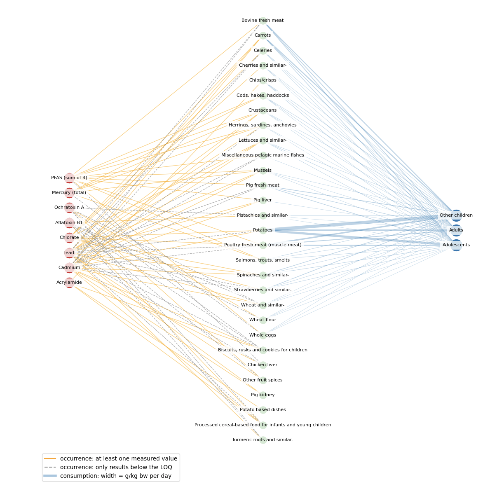

# Food contaminant exposure network for Belgium

A small project exploring how public EFSA data can be turned into a network of contaminants, foods and consumers.

## Approach

Data sources:
- **Occurrence:** [Belgian chemical monitoring results 2024](https://doi.org/10.5281/zenodo.22842407), FASFC and FPS Health, Zenodo, CC BY 4.0
- **Catalogues:** [EFSA DCF catalogues](https://doi.org/10.5281/zenodo.18429596) for foods (FoodEx2), substances and units, Zenodo, CC BY 4.0
- **Consumption:** [EFSA Comprehensive European Food Consumption Database](https://www.efsa.europa.eu/en/data/food-consumption-data), Belgian survey 2014 (chronic, g/kg bw per day, all subjects)

The notebook builds the raw tables of a directed, weighted tripartite network [Kivelä et al. (2014)](https://doi.org/10.1093/comnet/cnu016): 
- Nodes: contaminants, food groups and population groups form three separate node layers
- Edges: range from contaminants to food groups (occurrence, mean concentration in mg/kg) and from food groups to population groups (consumption in g/kg per day).
- Pipeline: After removing suspect samples (=ST30A), the notebook keeps eight contaminants with an EFSA health-based guidance value (TWI, TDI) or reference point (BMDL) and the 30 foods with at least 25 results, and links them to the consumption data through the FoodEx2 hierarchy at Level 4. Results below the limit of quantification (LOQ) are set to the LOQ as an upper bound and flagged.
- To run it in Google Colab, upload the consumption export as `Foodex 2 L4 dashboard.xlsx`.

*Light blue: the Level 4 groups that link the occurrence data to the consumption data. Orange: five foods that sit above Level 4 and are therefore linked with their own code.*

## Major findings

- **Most of the network is unknown:** Of the 232 possible pairs of contaminant and food group, 148 (64%) were never measured, 29 have results below the LOQ only, and just 55 have at least one measured value.
- **Censoring dominates:** 89.9% of the 127,543 Belgian results are below the LOQ and only 5.3% are measured values. Even for the eight contaminants, about two thirds of the results are censored.
- **The data sources do not fit together directly:** Samples are coded as specific foods ("Strawberries"), consumption as broader groups ("Strawberries and similar-"), so only 9 of the 30 foods match by name. Linking at Level 4 turns the 30 foods into 29 food groups.
**Consumption data are incomplete:** 7 of the 29 groups have no consumption data in the 2014 survey (see network figure).

*Left: 8 contaminants, middle: 29 food groups, right: 3 population groups. Orange lines are occurrence edges with at least one measured value, grey dashed lines have results below the LOQ only, and missing lines mean the pair was never measured. Blue lines are consumption edges, their width shows the amount eaten in g/kg bw per day. The food groups at the bottom have no consumption data.*

## Research opportunities

The network is incomplete for three reasons: Monitoring is risk-based, so each contaminant is only analysed in the foods where it is expected or regulated. Most results fall below the LOQ, so only an upper bound is known. And the consumption survey does not cover every food or population group. The gaps therefore follow a pattern: whether a pair was measured depends on the expected risk, and whether a value is censored depends on the concentration itself. Filling them with 0 or with the LOQ would hide this uncertainty. This opens up the opportunity to estimate the missing and censored links by combining fuzzy clustering with Bayesian inference.

1. **Fuzzy groups of foods.** Similar foods are grouped by what they are (FoodEx2 hierarchy, source animal, body part, processing), not by their censored values. A food can belong to several groups at once: pig liver is partly a pig product and partly an inner organ, where cadmium builds up.
2. **Estimating the missing links.** A Bayesian model estimates each missing or censored link as a range of likely values instead of a single number. Results below the LOQ still count as information, and foods with few or no results borrow from the groups they belong to, so their ranges stay wider.
3. **Decision support.** Passed through the network, these ranges show how likely each population group is to exceed a contaminant's reference value, and additionally where one more sample would reduce the uncertainty the most.

These ideas build on [Kivelä et al. (2014)](https://doi.org/10.1093/comnet/cnu016) on multilayer networks, [Babuška (1998)](https://doi.org/10.1007/978-94-011-4868-9) on fuzzy modelling and [van den Berg et al. (2013)](https://doi.org/10.1109/TFUZZ.2012.2235839) on probabilistic fuzzy systems, as well as on [Maudoux et al. (2006)](https://doi.org/10.1080/01652176.2006.9695220) and [Regulation (EU) 2017/625, Art. 9](https://eur-lex.europa.eu/eli/reg/2017/625/oj) on risk-based food safety monitoring.

**License:** Code under the MIT License. The data keep their original licences: CC BY 4.0 for the Zenodo records, EFSA's terms of use for the consumption export.
